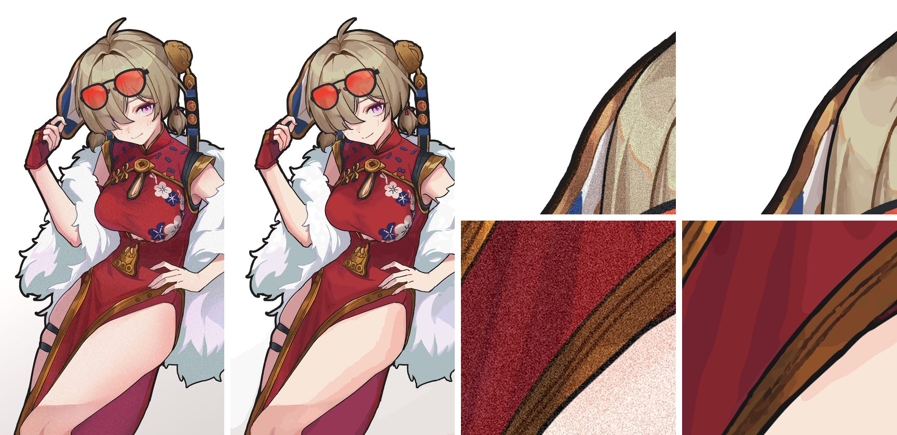
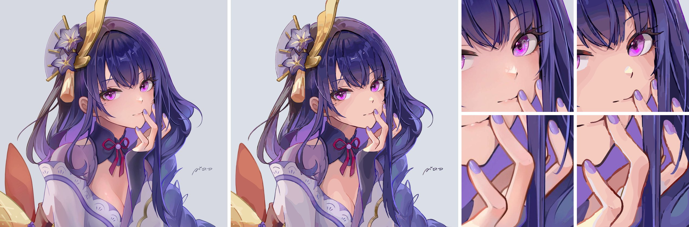

# Lumina-Vec

[](https://github.com/MESFET5198/Lumina-Vec/releases/latest)

把二次元插画转成 SVG，用于导入 [Lumina-Layers](https://github.com/lumina-layer-studio/Lumina-Layers) 做多色叠层 3D 打印。处理流程是：AI 去颗粒 → 明暗分层 → AI 线条层（两个线稿模型）→ 色块描摹（亚像素等值线 + 贝塞尔），另有专门针对打印的清理模式。各版本的改动见 [CHANGELOG](CHANGELOG.md) 或 [Releases](https://github.com/MESFET5198/Lumina-Vec/releases)。

| 带颗粒的平涂（`shading`） | 厚涂（`shading-detail`） | 平涂赛璐璐（`cel`） |
|---|---|---|
|  |  |  |

<sub>每张图左半是原图，右半是 Lumina-Vec 的转换结果；最右侧为局部放大对比。示例由 v0.7 生成。示例插画版权归原作者所有，仅用于效果对比。</sub>

## 快速开始

**Docker（含 Web UI）**

```bash
docker compose up -d --build      # 构建时会自动下载三个模型（约 390 MB）
# 浏览器打开 http://<主机>:8091
```

Web UI 支持拖拽或粘贴上传、预设选择、打印尺寸和精细模式，高级选项里可以调颜色数、线条层、线条风格、细纹保护和色块描摹方法。结果可以拖动对比线、滚轮放大检查，会显示转换进度。转换记录保存在 `/data/jobs.json`，重启或重建容器不会丢；被重启打断的任务会标成"中断"，可以一键用原来的设置重试，也可以删除记录和对应文件。

更新：`git pull` 后重新执行 `docker compose up -d --build`。

**命令行**

```bash
pip install numpy pillow opencv-python-headless scikit-image scipy
pip install torch --index-url https://download.pytorch.org/whl/cpu      # 有 N 卡就换成 CUDA 版
pip install --pre "vtracer==1.0.0a3"
./scripts/download_weights.sh

python -m lumina_vec.pipeline in.png out.svg                           # 自动选预设
python -m lumina_vec.pipeline in.png out.svg --print-mm 263            # 打印模式
python -m lumina_vec.pipeline in.png out.svg --fine                     # 精细模式（实验）
```

## 预设

默认是 `auto`，会根据图片自动选择：

| 预设 | 自动选择的条件 | 适合的图 | 线条层 |
|---|---|---|---|
| `shading` | 颗粒度 ≥ 4 | 带颗粒、噪点的平涂图 | 开 |
| `cel` | 平缓渐变占比 < 0.18 | 干净的平涂赛璐璐 | 开 |
| `shading-detail` | 其余情况 | 厚涂、带渐变的插画 | 关 |

线条层开启时，默认使用 v3 线条（见下）；打印模式固定用旧方法，保证最小线宽。轮廓淡、线条细的厚涂图（比如精灵、狐耳那类），建议打开精细模式或手动开启线条层。

另外还有 `illustration`、`detail`、`flat` 三个不分层的旧预设，只能手动指定。大图会自动缩小处理，`shading` 上限 1400 万像素，其余 600 万像素。判断阈值只用 6 张测试图标定过，效果不对时可以手动指定 `--preset`。

## 精细模式（实验）

Web UI 的"精细模式"开关，命令行 `--fine`：

- 新线条层（v3）：manga_line 和 lineart_anime 两个线稿模型决定线在哪里，原图的墨色决定线有多粗，线条连贯、交叉处干净，颜色按每段线从原图取；
- 颗粒不重的图不再先缩小一半再去颗粒，工作分辨率提到 2 倍（上限 600 万像素）；
- 淡的细纹（背景花纹、针织纹、发丝）不会被渐变平滑抹掉。

5 张测试图里，轮廓淡、细节多的图提升明显（色差：精灵 3.18 → 2.67、狐耳 3.43 → 2.90、花纹背景那张 3.04 → 2.10，测试时用 Vecto 描线，自带描线是 2.32），其余持平。代价是更慢、路径更多。打印模式下线条层仍用旧方法，保证最小线宽。

线条描摹如果找到 [Vecto](https://github.com/DanielMevit/Vecto) 命令行（`VECTO_CLI` 环境变量或 PATH 里的 `vecto`）会调用它，效果略好；没有就用自带的描线，Docker 镜像里默认不带。

## 3D 打印模式

```bash
# 只打印一部分时：先裁切，--print-mm 填裁切后的图在打印时长边的尺寸
python -m lumina_vec.pipeline crop.png out.svg --print-mm 263 --line-mm 0.42
```

- 比一根挤出线还窄的色块和碎块会并入相邻颜色，画面保持完整、不留空洞；
- 细线（轮廓、发丝、嘴）不删，而是整条加粗到线宽，所以线条会比原图略粗；
- 颜色数降到 56，描摹改用共边模式；
- 预览用的遮缝描边导入 Lumina 时会被自动删掉。

实测同一张图：预估打印时间从 10h04m 降到 8h56m，周长小于 2 mm 的外墙小圈减少约一半。切片端把回抽最小距离调到 4.5 mm 后，降到 8h28m。

检查工具：

```bash
python -m lumina_vec.printcheck out.svg --print-mm 263       # 切片前：统计比挤出点还小的区域
python -m lumina_vec.gcodecheck a.gcode b.gcode               # 切片后：对比小圈数、空驶、回抽和预估时间
```

## 常用参数

| 参数 | 作用 |
|---|---|
| `--preset` | `auto` / `shading` / `shading-detail` / `cel` / … |
| `--bands N` | 颜色数，越少打印出来的区域越少 |
| `--print-mm` / `--line-mm` | 打印尺寸（长边，mm）/ 挤出线宽，默认 0.42 |
| `--ink 0/1` | 强制关闭或开启线条层 |
| `--lines none` | 线条层不用 AI 模型，改按颜色规则找线 |
| `--fine` | 精细模式（见上） |
| `--line-style v3/contour` | 线条层新旧方法，默认 v3（打印模式固定旧方法） |
| `--thin-thr X` | 细纹保护强度，0 关闭，精细模式 0.015 |
| `--tracer contour/vtracer` | 色块描摹方法，默认自带（打印模式固定 vtracer） |
| `--work-scale` | 处理时的分辨率倍数 |
| `--clean img` | 使用其他机器上已做完 AI 去颗粒的图（见下） |

**把 AI 步骤放到 GPU 主机上跑**：先在 GPU 主机上运行 `python -m lumina_vec.denoise in.png clean.png`，再在主力机上运行 `python -m lumina_vec.pipeline in.png out.svg --clean clean.png`。不过 AI 步骤只占总耗时的约 20%，整体放到 GPU 主机上跑效果更明显。

## 已知限制

- 印章小字这类小于 2 mm 的细节会糊掉；腮红会变成硬边色块；
- 带色差特效（红青描边）的图，打印模式下青色边可能会丢失；
- 打印模式下，线条与色块交界处会残留零星 1～2 像素的点。按像素统计会算进碎块数，但实际打印影响很小；
- 精细模式：白发等浅色区域上的淡线有时会断开；眼睛内部的细节仍不如商业工具；路径数较多（1000 px 级的图约 1.4 万条）；
- 厚涂图开启线条层时，眼睛高光可能变弱（雷电那类图建议保持关闭）；
- 实现细节、实测数据和试过但放弃的方案，见 [docs/NOTES.md](docs/NOTES.md)。

## 版本与发布

版本号用 `0.x`：加功能升第二位，只修问题升第三位。发布方法：在 `.github/release-notes/versions.txt` 加一行"版本号 提交"，并写好 `.github/release-notes/<版本号>.md`（第一行是标题），推到 `main` 后，GitHub Actions 会自动打 tag 并建 Release。在网页上手动打 `v*` tag 也会触发。

## 依赖与许可

- [vtracer](https://github.com/visioncortex/vtracer)：MIT
- [MangaLineExtraction_PyTorch](https://github.com/ljsabc/MangaLineExtraction_PyTorch)（manga_line，`lumina_vec/manga_net.py` 与权重 erika.pth）：MIT
- [Vecto](https://github.com/DanielMevit/Vecto)：AGPL-3.0，可选的外部命令行工具，不包含在本项目中
- [Real-ESRGAN](https://github.com/xinntao/Real-ESRGAN) `realesr-animevideov3`：BSD-3-Clause
- [ControlNet Annotators](https://huggingface.co/lllyasviel/Annotators) `lineart_anime`（`netG.pth`）：许可见上游仓库
- 模型权重不随仓库分发，需要单独下载
- `docs/` 中的示例插画版权归原作者所有，仅用于展示转换效果
